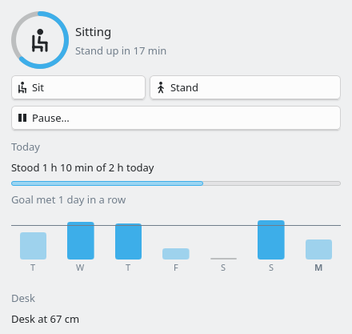
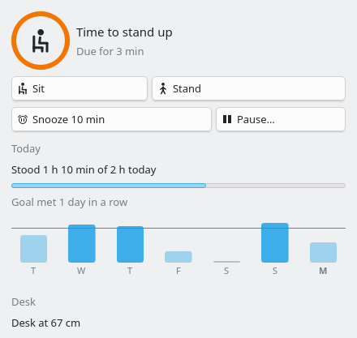
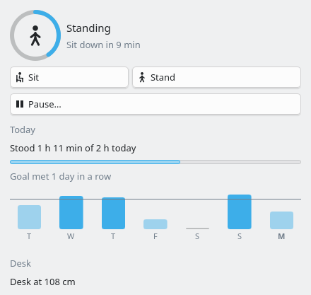

# Shift

A Plasma 6 widget that reminds you to switch between sitting and standing, and can move a
motorized desk for you.

| | | |
| --- | --- | --- |
|  |  |  |
| Sitting, with the week so far | A switch is due | Standing, with the desk raised |

- A sit/stand cycle with its own timer: 45 minutes sitting, 15 standing by default.
- A notification when it is time to switch, with **Sit/Stand now** and **Snooze**.
- Daily standing time against a goal, and a streak of days that met it.
- A week of standing time as a chart in the popup.
- Paused while the screen is locked. Away 5 minutes or more starts the cycle over.
- **Pause** for a meeting (30 min, 1 h, 2 h or until resumed), and optional working hours
  outside which the cycle stops.
- Reminders wait while Do Not Disturb is on, and show once it ends.
- Middle-click the panel icon to switch between sitting and standing without opening the
  popup.

## Install

Download the latest package from [releases/](releases/) and run
`kpackagetool6 -t Plasma/Applet -i shift_v1.2.2.plasmoid`, or from the source:

```sh
make install     # first time
make upgrade     # after changes
```

Then add **Shift** to a panel or the desktop.

Besides the widget, `make install` puts its icons in
`~/.local/share/icons/hicolor/scalable/apps/`, because Plasma looks a widget's icon up by
name. Installed from a `.plasmoid` file instead, the widget works but the tooltip and the
widget list show no icon.

## Desk control

Qt 6 has no QML API for Bluetooth, so the widget drives the desk through a command-line
tool. The defaults use [idasen](https://github.com/newAM/idasen), which works with IKEA
Idåsen and other Linak desks:

```sh
pipx install idasen
idasen init        # finds the desk and writes ~/.config/idasen/idasen.yaml
idasen height      # should print the height
```

Pair the desk in System Settings → Bluetooth first. The sit and stand heights for
`idasen sit` / `idasen stand` live in idasen's own config file.

Then, in the widget's settings, under **Desk**:

1. Turn on **Control a motorized desk**.
2. Press **Test connection**. It runs the height command and shows what it read.
3. Move the desk to your sitting height and press **Use current height for sitting**, then
   the same for standing. This sets the widget's preset and runs `idasen save sit` (or
   `stand`), so idasen and the widget agree on the heights. Above their midpoint counts
   as standing.

Any other tool works too. The commands run with `sh`, and `{cm}`, `{mm}` and `{m}` are
replaced with the preset height, for example `linak-controller --move-to {mm}`. The height
command may print the height in metres, centimetres or millimetres.

The widget reads the height every minute, so moving the desk with its own buttons is
noticed too and the standing time stays right.

When the desk does not answer (off, out of range, asleep), the panel icon shows a warning
triangle and nothing raises an error. A switch you ask for then waits until you have made
it with the desk's own buttons and press **Done** (in the notification, in the popup, or
with another middle click); until then the count stays in the old position. The next
successful height read switches back to driving the desk.

A move that stops short of the preset (Linak desks do this now and then) is run again,
up to 8 times. Two moves in a row that do not move the desk at all end the retries:
something may be in the way, and the desk stopping is its anti-collision at work.

**Move the desk when it is time to switch** is off by default. A desk that moves on its
own can catch a chair arm, a cable or a shelf. Turn it on only if nothing can be caught.

## Limitations

- Away is the screen lock, not idle time. KDE's Wayland session answers
  `org.freedesktop.ScreenSaver.GetSessionIdleTime` with `NotSupported`. Plasma locks after
  its own idle timeout, so in practice this follows idleness too.
- The popup cannot show the height while the desk moves. The command reports nothing
  until it exits, and idasen holds the desk's only Bluetooth connection while moving.
- Standing time is credited to the day it is saved on, once a minute, so at most a minute
  of a session that spans midnight lands on the wrong day.

## Development

```sh
make check       # qmllint, config and theme audits, qmltestrunner
```

The testable logic is plain JavaScript in `package/contents/ui/lib/`: `cycle.js` for the
cycle and stats, `desk.js` for building desk commands and reading their output.

To try changes without touching the installed copy:

```sh
XDG_DATA_HOME=/tmp/stand-test make install
XDG_DATA_HOME=/tmp/stand-test plasmawindowed com.dv.stand
```

QML errors show up in `journalctl --user -f`.

The README screenshots come from `tools/screenshot/shoot.sh STATE OUT.png` (`sit`, `due` or
`stand`, optionally with `-offline`). It runs the widget alone in a headless KWin with sample
data, so nothing else on the desktop ends up in the picture.

Several parts are taken from Fokus: `ExecUtil.qml`, `NotificationManager.qml`, `Sfx.qml`,
`ProgressCircle.qml`, `FormPathDelegate.qml`, the Makefile and the audits in `tests/`.

## Support

If the widget is useful to you, you can buy me a coffee on
[Ko-fi](https://ko-fi.com/divinae4535).

## License

GPL-3.0-or-later, see `LICENSE`. Parts are taken from Fokus, which is under the same license.
